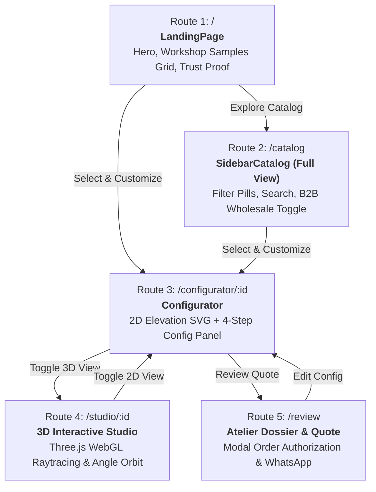
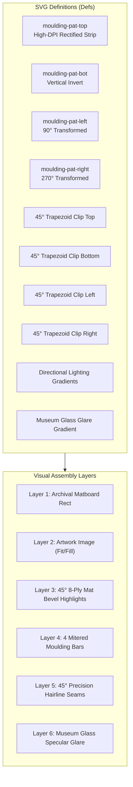

# Sanskruti Arts Atelier — UI & Architectural Design Guide

An in-depth guide to the user interface architecture, responsive layout structures, design system tokens, 2D/3D rendering engines, and component hierarchy for **Sanskruti Arts Atelier**, an Indian manufacturer of decorative picture frame mouldings.

---

## 🏛️ 1. Executive Brand Identity & Design System

The application is styled following the **Stitch Modern Botanical Luxury** design language — blending old-world guild craftsmanship with contemporary architectural precision.

```
┌────────────────────────────────────────────────────────────────────────┐
│                        SANSKRUTI ARTS ATELIER                          │
│        Est. 1994 · Guild Archivists · 3D Extrusion Studio              │
└────────────────────────────────────────────────────────────────────────┘
```

### 1.1 Color Palette & Aesthetic Tokens

| Token Name | Hex Code | Tailwind / Role | Usage Context |
| :--- | :--- | :--- | :--- |
| **Deep Forest (Primary Dark)** | `#24382F` | `bg-[#24382F]`, `text-[#24382F]` | Headers, primary buttons, brand crests, active navigation pills |
| **Florentine Bronze (Accent)** | `#B47C55` | `text-[#B47C55]`, `bg-[#B47C55]` | Selected rings, gold icons, hover transitions, primary badges |
| **Gilded Amber (Glow)** | `#C8933C` | `text-[#C8933C]`, `border-[#C8933C]` | CAD dimension callouts, crosshairs, architectural lines |
| **Atelier Alabaster (Canvas)** | `#F7F5EF` | `bg-[#F7F5EF]` | Application background canvas, card backing |
| **Warm Gallery Stone** | `#E8E4DA` | `border-[#E8E4DA]`, `bg-[#ECEFEA]` | Card borders, dividers, subtle input fields, default wall |
| **Pristine Linen** | `#FAF8F5` | `bg-[#FAF8F5]` | Header background, blueprint architectural grid canvas |
| **Obsidian Charcoal** | `#1C1917` | `text-[#1C1917]`, `bg-[#1C1815]` | Typography headers, 3D studio background base, miter seams |
| **Muted Slate** | `#78716C` | `text-[#78716C]` | Subheadings, technical dimension labels, secondary text |
| **Emerald Verification** | `#047857` | `text-emerald-700`, `bg-emerald-500` | In-stock badges, active selection indicators |
| **WhatsApp Emerald** | `#25D366` | `bg-[#25D366] hover:bg-[#20ba59]` | WhatsApp quotation inquiry call-to-action buttons |

### 1.2 Typography Hierarchy

- **Serif Primary (`font-serif`)**: *Cormorant Garamond* & *Playfair Display* (weights 500, 600, 700) for atelier titles, frame names, pricing callouts, and section titles.
- **Sans Primary (`font-sans`)**: *DM Sans* & *Plus Jakarta Sans* (weights 400, 500, 600) for body text, form controls, spec descriptions, and interactive labels.
- **Monospace Technical (`font-mono`)**: JetBrains / system monospace for SKU badges (`#SAA-FLR-01`), outer dimensions (`16 × 20 in`), CAD tolerances, and pricing mathematics.

---

## 🗺️ 2. Global Routing & Page Architecture

Routing is managed via HTML5 History API (`window.location.pathname`) with backward/forward popstate handling through `src/utils/routes.ts`:



---

## 📐 3. Responsive Layout Grid & Viewport Breakpoints

The application enforces a rigid responsive architecture across desktop, tablet, and mobile:

### 3.1 Desktop Layout (`lg:`, `xl:`, `2xl:` $\ge$ 1024px)
Split-column 60/40 viewport with locked vertical scrolling:
```
┌──────────────────────────────────────────────────────────────────────────────┐
│ [SA] Sanskruti Arts   [Home] [Catalog] [Configure] [3D Studio] [Review] [₹/$]│
├──────────────────────────────────────────────┬───────────────────────────────┤
│                                              │ 1. Artwork Cavity Specs       │
│                                              │    Width: [ 16 ] Height: [ 20]│
│            PREVIEW VIEWPORT                  │    [Portrait] [Landscape]     │
│                                              ├───────────────────────────────┤
│   - 2D Blueprint / Realistic Render SVG      │ 2. Archival Matboard Tier     │
│     OR 3D WebGL Three.js Canvas              │    [Rag] [Linen] [None]       │
│                                              ├───────────────────────────────┤
│   - Outer Dimensions overlay: 28" × 32"      │ 3. Artwork in Frame           │
│   - View switchers & wall environment        │    [Upload] [Fit] [Fill]      │
│   - 4K Snapshot & CAD Dimension badges       ├───────────────────────────────┤
│                                              │ 4. Hardware & Glazing         │
│                                              │    [Optium Museum Glass]      │
│                                              ├───────────────────────────────┤
│                                              │ Estimated Valuation: ₹3,850   │
│                                              │ [ 3D Studio ] [ Review Quote] │
│                                              │ [ Enquire on WhatsApp       ] │
└──────────────────────────────────────────────┴───────────────────────────────┘
```

### 3.2 Mobile & Small Viewports (`< 1024px`)
- **Sticky Top Bar**: Displays brand mark, active route pills, and currency toggle.
- **Vertical Stack**: The visualizer is positioned at the top (`min-h-[380px]`), followed by scrollable configuration controls.
- **Sticky Mini Preview Bar**: Stays anchored to the bottom of the screen when the customer scrolls through options:
  ```
  ┌────────────────────────────────────────────────────────────────┐
  │ [Thumb] Florentine Acanthus · 16×20 in · ₹3,850  [3D] [Review] │
  └────────────────────────────────────────────────────────────────┘
  ```

---

## 🖼️ 4. Visualizer Engine Architecture

### 4.1 2D Architectural Blueprint & Realistic Render (`FrameCanvas2D.tsx`)
The 2D visualizer renders scalable vector graphics (SVG) with namespaced clip-paths and lighting overlays:



#### The 3 Sub-Modes:
1. **`blueprint` (Architectural Elevation)**:
   - Technical drafting grid (`radial-gradient #C8933C`).
   - 45° dashed miter corner construction lines.
   - Profile tier subdivision offsets (`outerStep = fW * 0.16`, `friezeStep = fW * 0.80`).
   - Precision CAD registration crosshair with outer dimension labels.
2. **`render` (Realistic Render)**:
   - Fills each miter trapezoid with the photometric rectified texture extracted from the actual workshop sample photograph.
   - Applies multi-tier directional key light gradients (ambient top highlight, indirect bottom bounce, left side key, right cast shadow).
   - Inner sightline beaded fillet for baroque profiles.
   - Authentic 45° miter joint hairline seams (`rgba(0,0,0,0.50)` shadow paired with `rgba(255,255,255,0.40)` bevel highlight).
3. **`exploded` (CAD Exploded Assembly)**:
   - Smoothly translates the 4 mitered frame bars outward by 24px (`translate(0, -24)`, `translate(0, 24)`, etc.).
   - Scales the archival matboard to 95% and the artwork canvas to 90% with CSS spring transitions, demonstrating interior depth.

---

### 4.2 3D Interactive Raytracing Studio (`ThreeFrameViewer.tsx`)
Built with **Three.js** in a WebGL canvas with real-time PBR shaders and touch orbit controls:

#### Camera Presets:
- **Macro Corner Miter (45°)**: Camera at `[1.3, 1.1, 1.8]`, centered on the top-left 45° miter joint for close inspection of carving relief and corner alignment.
- **Full Elevation**: Orthographic-style perspective `[0, 0, 3.2]` looking directly at the face of the framed artwork.
- **Cross-Section CAD**: Low angle `[0, -1.8, 1.2]` showcasing molding extrusion depth, rabbet shelf, and wall offset.
- **Wall Perspective**: Dramatic room perspective `[-1.8, 1.2, 2.8]` with soft shadow drop.

#### Lighting Environments:
- **3000K Museum Warm**: Primary key light at `[5, 8, 6]` with warm amber fill (`#fff0d4`), mimicking halogen gallery spotlights.
- **5500K Daylight**: Clean white key light (`#f8faff`) with balanced ambient sky fill.
- **2400K Candlelight**: Rich intimate gold light (`#ffb05c`) that accentuates gold foil and distressed boles.
- **Studio Neutral**: Low-contrast high-diffusion photography light (`#f0ede8`).

#### Resource & Lifecycle Safety:
- Recursive node traversal (`disposeThreeNode`) disposes all buffer geometries, uniforms, materials, and textures on component unmount.
- Prevents WebGL context loss and browser memory leaks during rapid molding switching.

---

## 🎛️ 5. Configuration Panel Architecture (`ConfigurationPanel.tsx`)

The configuration panel guides users through an intuitive 4-step workflow:

```
┌────────────────────────────────────────────────────────┐
│ STEP 1: ARTWORK CAVITY SPECS                           │
│   Width & Height numeric inputs with min/max bounds    │
│   Portrait / Landscape orientation switcher            │
│   IN / CM dual-unit toggles                            │
│   Standard Museum Presets: 8×10, 11×14, 16×20, 24×36   │
├────────────────────────────────────────────────────────┤
│ STEP 2: ARCHIVAL MATBOARD TIER                         │
│   Four archival museum rag tiers (Cotton, Linen, etc.) │
│   Continuous border width reveal slider: 1.0" to 5.0"  │
├────────────────────────────────────────────────────────┤
│ STEP 3: ARTWORK IN FRAME                               │
│   Upload custom photograph / painting (FileReader)     │
│   Curated master artwork selection                     │
│   Artwork Fit Mode: [Fill Frame (Crop)] / [Fit Whole]  │
├────────────────────────────────────────────────────────┤
│ STEP 4: HARDWARE & GLAZING (Collapsible Accordion)     │
│   Tru-Vue Optium Museum Acrylic (99% UV Blocking)      │
│   UltraVue 70 Anti-Reflective Water-White Glass        │
│   Precision Z-Bar French Cleats vs Aircraft Wire       │
├────────────────────────────────────────────────────────┤
│ VALUATION TRAY & COMMISSION ACTION                     │
│   Dual-Currency Switcher: [ ₹ INR ] [ $ USD ]          │
│   One-Click "Share Spec" live link generator           │
│   Total Commission Valuation readout                   │
│   [ 3D Studio ]  [ Review Quote ]                      │
│   [ Enquire on WhatsApp (#SKU) ]                       │
└────────────────────────────────────────────────────────┘
```

---

## 🏭 6. B2B Wholesale Catalogue Mode (`SidebarCatalog.tsx`)

Designed for Indian picture framing businesses, galleries, and interior contractors:

### Switcher Options:
1. **Artisan Custom Framing (Retail)**:
   - Displays linear foot rates (`$48 / ft` or `₹420 / ft`).
   - "Select & Customize" leads to individual frame dimensioning.
2. **B2B Wholesale Mouldings (Carton Lots)**:
   - Displays industrial packaging metrics:
     - **Stick Length**: Standard 9.0 ft or 9.5 ft mouldings.
     - **Carton Capacity**: 10 to 24 sticks per master carton.
     - **Total Carton Yield**: 90 to 228 linear feet per box.
     - **Wholesale Pricing**: `₹420 / ft` $\rightarrow$ `₹45,360 / master carton`.
     - **Volume Tier Badges**: 12% discount (5+ boxes), 22% discount (20+ boxes).
     - **Instant B2B WhatsApp CTA**: Sends structured carton inquiry directly to workshop management.

---

## 🔗 7. Deep-Linking & State Persistence

The URL acts as a single source of truth for sharable frame specifications:

```
https://sanskrutiarts.com/configurator/SAA-FLR-01?w=16&h=20&unit=in&mat=mat-offwhite&bw=2.5&fit=fill
```

### URL Parameters Schema:
| Parameter | Type | Default | Description |
| :--- | :--- | :--- | :--- |
| `w` | `number` | `16` | Artwork cavity opening width |
| `h` | `number` | `20` | Artwork cavity opening height |
| `unit` | `'in' \| 'cm'` | `'in'` | Measurement unit |
| `mat` | `string` | `'mat-offwhite'` | Archival matboard option ID or `'none'` |
| `bw` | `number` | `2.5` | Matboard border reveal width in inches |
| `fit` | `'fill' \| 'fit'`| `'fill'` | Artwork aspect-ratio fit strategy |
| `art` | `string` | `'art-default'` | Selected curated artwork ID |
| `glz` | `string` | `'optium'` | Glazing tier selection |
| `wall` | `'stone' \| 'forest' \| 'linen'` | `'stone'` | Visualizer background wall color |

---

## 📱 8. WhatsApp Inquiry Format

Clicking the WhatsApp CTA automatically formats an itemized message via `src/utils/whatsapp.ts`:

```
*Sanskruti Arts Atelier — Custom Framing Inquiry*
----------------------------------------
*Moulding:* Florentine Acanthus Baroque Gilt (#SAA-FLR-01)
*Profile Width:* 3.25" face
*Artwork Opening:* 16 × 20 in
*Archival Mat:* Museum Cotton Rag (2.5" border)
*Conservation Glazing:* Tru-Vue Optium Museum Acrylic
*Hanging Hardware:* Precision Z-Bar French Cleat
*Estimated Quotation:* ₹3,850
----------------------------------------
*Direct Studio Link:* https://sanskrutiarts.com/configurator/SAA-FLR-01?w=16&h=20&unit=in&mat=mat-offwhite&bw=2.5&fit=fill

Please advise on production lead time and freight options for our atelier.
```

---

## 🛠️ 9. Component File Reference

```
src/
├── components/
│   ├── Header.tsx                 # Studio crest, navigation tabs, outer dimensions, currency toggle
│   ├── SidebarCatalog.tsx         # Moulding search, category pills, B2B wholesale carton switcher
│   ├── FrameCanvas2D.tsx          # Scaled SVG visualizer with 3 sub-modes (Blueprint, Render, Exploded)
│   ├── ThreeFrameViewer.tsx       # Three.js 3D WebGL scene with orbit controls and resource disposal
│   ├── PreviewCanvas.tsx          # Dual-engine canvas wrapper, 4K snapshot, wall color switcher
│   ├── ConfigurationPanel.tsx     # 4-step customization panel with pricing and mobile mini-preview
│   ├── AtelierQuoteModal.tsx      # Formal commission review dossier (#SAA-8842) & authorization
│   ├── FrameDetailModal.tsx       # Macro craftsmanship inspection modal with profile cross-section
│   └── LandingPage.tsx            # Atelier brand showcase, collection overview, and workshop chevrons
├── data/
│   ├── frames.ts                  # Retail catalogue profiles, archival mats, artworks, cavity presets
│   ├── workshopSamples.ts         # Authentic workshop chevron photography metadata
│   └── wholesale.ts               # B2B stick lengths, carton yields, trade pricing & volume discounts
├── types/
│   └── index.ts                   # Central TypeScript types & interfaces
└── utils/
    ├── frameConfig.ts             # Configuration clamping, query serialization & deserialization
    ├── mouldingReconstruction.ts  # Homography rectification, High-DPI textures, cache pre-warming
    ├── frameRendering.ts          # Physical material profile classification (wood, gold, distressed)
    ├── pricing.ts                 # United inches, linear feet, perimeter waste, and currency conversion
    ├── routes.ts                  # Route parsing with query string parameters
    ├── whatsapp.ts                # Centralized WhatsApp telephone line & message formatting
    └── mouldingStorage.ts         # LocalStorage sync and reset mechanisms
```

---

## 🚀 10. Running & Building

### Development Server
```bash
npm run dev
```

### Type Checking & QA Suite
```bash
npx tsc --noEmit
node tests/qa_suite.cjs
```

### Production Build
```bash
npm run build
```
Generates an optimized production build in `dist/` with automated CSS minimization and vendor chunk splitting.
